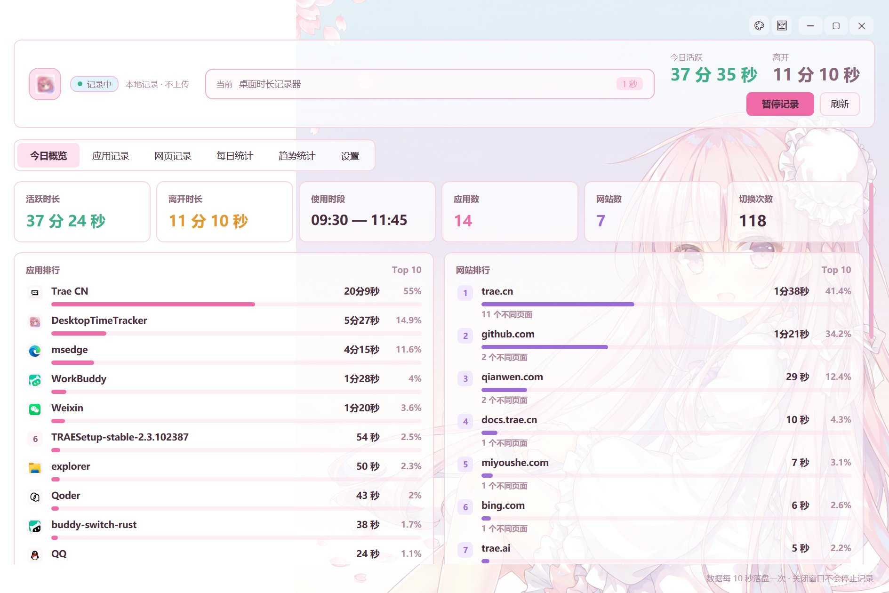

# 桌面时长记录器 · DesktopTimeTracker

一个纯本地的 Windows 桌面时间追踪工具：自动统计你在每个应用、每个网站上停留了多久，并配有一只可互动的 **3D 二次元桌宠**陪着你。

所有数据只写入本机 SQLite 文件，**不联网、不上传、不读取网页内容**。

<p align="center">
  
  <br>
  <sub>今日概览 · 活跃 / 离开时长、应用与网站排行一目了然</sub>
</p>

---

## ✨ 功能特性

### 时间记录
- **应用时长统计**：按前台焦点窗口记录，精确到进程（`msedge`、`idea64`、`QQ`…）
- **网站时长统计**：通过 UI Automation 读取 Chrome / Edge / Firefox 等浏览器地址栏，按**域名**聚合停留时长
- **离开判定**：超过设定时间无键鼠输入、锁屏、停留在桌面时，自动停止计时并计入"离开"
- **碎片降噪**：聚合时合并相邻会话、丢弃 2 秒以下的焦点闪烁碎片，排行更干净
- **崩溃恢复**：`daily_summary` 心跳 + 清洁退出标记，断电/强杀后重启会提示并保留已落库数据

### 统计视图
- **今日概览**：活跃/离开时长、使用时段、应用数、网站数、切换次数
- **24 小时分布**：跨小时会话按秒拆分归属，柱子真实反映每小时活跃量
- **应用排行 / 网站排行**：Top 10 + 占比条，应用排行显示**程序图标**
- **分类占比**：自动把应用与域名归入 工作 / 沟通 / 上网 / 娱乐 / 学习 / 其他，堆叠条 + 图例
- **趋势统计**：近 7 天 / 30 天每日活跃柱状图（可点击跳转到当天）、区间汇总、区间应用排行
- **明细查询**：应用/网页逐条记录，支持搜索、日期切换（‹ 今天 ›）、会话数/页面数统计
- **每日统计**：最近 14 天柱状图 + 全量日汇总表格

### 提醒与目标
- **久坐提醒**：连续活跃满 N 分钟（可自定义任意分钟数，0 = 关闭）时弹出通知
- **喝水提醒**：完全按**本地整点**触发（默认 10、11、14、15、16、17 点），与运行时长无关，时刻表可自定义
- **每日目标**：设定每日活跃目标，概览页显示进度，达成时通知
- **全局快捷键**：`Ctrl + Alt + P` 随时暂停/继续记录

### 二次元桌宠
基于 **WebView2 + three.js + three-vrm** 实时渲染真实 VRM 模型，不是静态图片：

- **骨骼动画**：呼吸、重心摆动、眨眼（随机 2.5~7 秒）
- **头发 / 裙摆物理**：VRM SpringBone 实时摆动
- **动作库**：双手背后晃、原地踏步、比心、抱手、叉腰、说话手势，每 7~15 秒随机切换
- **鼠标跟随**：头、颈、胸分层跟随鼠标转动，身体也会轻微侧身
- **互动**：单击说话（弹气泡 + 颜文字 + 开心表情 + 手势）、双击打开统计面板、右键菜单
- **操作**：左键拖动 360° 旋转、`Ctrl` + 拖动移动窗口、滚轮缩放已锁定
- **位置记忆**：退出时保存位置，下次启动回到原处
- **提醒联动**：久坐 / 喝水 / 目标达成时，她会同步说话

### 其他
- 系统托盘常驻，关闭窗口只隐藏不中断记录
- 开机自启、启动最小化到托盘
- 全局无边框窗口 + 自绘标题栏（最小化 / 最大化 / 关闭到托盘）
- 二次元粉紫配色主题、半透明卡片
- CSV 导出当日应用 + 网页记录（UTF-8 BOM，Excel 直接打开不乱码）
- 忽略指定进程（如 `explorer`、`SearchHost`）
- 数据库位置自定义、一键压缩、按日期清理旧数据

---

## 🖥 技术栈

| 层 | 技术 |
|---|---|
| UI | .NET 10 / WPF（无边框 WindowChrome + 自定义主题资源字典） |
| 数据 | SQLite（`Microsoft.Data.Sqlite`，WAL + `synchronous=FULL`） |
| 前台窗口采集 | Win32 API（`GetForegroundWindow` / `GetWindowThreadProcessId` / `GetLastInputInfo`） |
| 浏览器网址 | UI Automation（读取地址栏 ValuePattern，多语言控件名匹配） |
| 桌宠渲染 | WebView2 + three.js r160 + @pixiv/three-vrm 3.0 + three-vrm-animation |
| 通知 | Windows App SDK 原生 Toast（失败回退托盘气泡） |
| 托盘 | WinForms `NotifyIcon` |

---

## 🚀 快速开始

### 环境要求
- Windows 10 1809+ / Windows 11
- [.NET 10 SDK](https://dotnet.microsoft.com/download)（自行构建时）
- Microsoft Edge WebView2 运行时（Win11 已预装，桌宠需要）

### 构建运行

```powershell
git clone https://github.com/grapefruit2002/DesktopTimeTracker.git
cd DesktopTimeTracker
dotnet build src/DesktopTimeTracker/DesktopTimeTracker.csproj
dotnet run --project src/DesktopTimeTracker/DesktopTimeTracker.csproj
```

### 发布为免安装版（自带运行时）

```powershell
dotnet publish src/DesktopTimeTracker/DesktopTimeTracker.csproj `
  -c Release -r win-x64 --self-contained true `
  -p:PublishSingleFile=false -p:PublishTrimmed=false `
  -o dist/win-x64
```

产物双击 `DesktopTimeTracker.exe` 即可运行，无需安装 .NET 运行时。

---

## ⚙️ 配置

配置文件：`%APPDATA%\DesktopTimeTracker\settings.json`

| 字段 | 说明 | 默认 |
|---|---|---|
| `DatabasePath` | 数据库文件路径 | `D:\data.db` |
| `PollIntervalMs` | 前台采样间隔（毫秒） | `1000` |
| `IdleThresholdSeconds` | 离开判定阈值（秒） | `180` |
| `FlushIntervalSeconds` | 会话落盘间隔（秒） | `5` |
| `TrackWebPages` | 是否记录浏览器网址 | `true` |
| `StartMinimized` | 启动时最小化到托盘 | `false` |
| `AutoStartWithWindows` | 开机自启 | `true` |
| `IgnoredProcesses` | 不记录的进程名列表 | `[]` |
| `BreakReminderMinutes` | 久坐提醒分钟数（0 = 关闭） | `60` |
| `DailyGoalMinutes` | 每日活跃目标分钟数（0 = 关闭） | `0` |
| `WaterReminderEnabled` | 喝水提醒开关 | `true` |
| `WaterReminderHours` | 喝水提醒整点列表 | `10,11,14,15,16,17` |
| `CategoryRules` | 分类规则：`进程名/域名 → 分类` | 内置默认规则 |
| `ShowPet` | 是否显示桌宠 | `true` |
| `PetLeft` / `PetTop` | 桌宠窗口位置 | 自动右下角 |

### 桌宠模型
把 VRM 模型放到：

```
%APPDATA%\DesktopTimeTracker\avatar.vrm
```

支持 VRM 0.x / VRM 1.0（单文件 `.vrm` / `.glb`）。若想播放烘焙动画，另放一个 `.vrma`：

```
%APPDATA%\DesktopTimeTracker\idle.vrma
```

没有模型文件时，桌宠会退回一个程序化生成的 3D chibi 小人。

---

## 🗂 目录结构

```
DesktopTimeTracker/
├─ src/DesktopTimeTracker/
│  ├─ App.xaml(.cs)              # 启动、单实例、托盘、全局热键、提醒调度
│  ├─ MainWindow.xaml(.cs)       # 主窗口（无边框 + 自绘标题栏）
│  ├─ Views/PetWindow.xaml(.cs)  # 桌宠窗口（WebView2 宿主）
│  ├─ ViewModels/MainViewModel.cs
│  ├─ Models/Records.cs
│  ├─ Tracking/
│  │  ├─ ActivityTracker.cs      # 前台轮询、会话管理、离开判定
│  │  ├─ BrowserUrlReader.cs     # UI Automation 读取浏览器地址栏
│  │  └─ TrackerSettings.cs
│  ├─ Data/TrackerDatabase.cs    # SQLite 读写、聚合查询
│  ├─ Services/
│  │  ├─ TrayIconService.cs      # 托盘图标与 Toast 通知
│  │  ├─ AppCategorizer.cs       # 工作/娱乐/学习等分类
│  │  ├─ AvatarLoader.cs         # glTF/VRM 解析（WPF 3D 回退渲染）
│  │  └─ AppIdentity.cs          # AUMID 与开始菜单快捷方式
│  ├─ Converters/                # 时长、百分比、图标、分类色等转换器
│  ├─ Controls/                  # RoundedClip 等自定义控件
│  ├─ Themes/Theme.xaml          # 配色与全部控件样式
│  └─ Assets/
│     ├─ app.ico / mascot.jpg    # 图标与立绘
│     └─ Web/                    # 桌宠网页层（three.js / three-vrm / pet.js）
└─ tools/DbAudit/                # 数据库核对工具（对账用）
```

---

## 🗄 数据库结构

| 表 | 说明 |
|---|---|
| `app_sessions` | 应用会话：`day, process_name, exe_path, window_title, start_time, end_time, duration_seconds, is_browser` |
| `web_sessions` | 网页会话：`day, browser, url, domain, page_title, start_time, end_time, duration_seconds` |
| `daily_summary` | 每日汇总：`day, active_seconds, away_seconds, first_start, last_end, app_switches` |
| `tracker_meta` | 运行时元数据：心跳时间、清洁退出标记 |

> 浏览器使用时，同一段时间会**同时**计入 `app_sessions`（浏览器整体时长）与 `web_sessions`（各网站时长）——前者是总量，后者是拆分，两者不是互斥关系。

---

## ⌨️ 快捷键

| 快捷键 | 功能 |
|---|---|
| `Ctrl + Alt + P` | 暂停 / 继续记录（全局生效） |
| 标题栏双击 | 最大化 / 还原 |
| 托盘双击 | 打开主窗口 |
| 托盘右键 | 打开主窗口 / 暂停记录 / 显示桌宠 / 退出 |

---

## 🔒 隐私说明

- 所有数据只写入本机 SQLite 文件，程序**不联网、不上传**
- 浏览器的无痕 / InPrivate 窗口只记录时长，网址统一替换为 `(隐私模式)`
- 不读取网页内容，仅通过 UI Automation 读取地址栏文本
- 可随时在设置中忽略指定进程，或清理历史记录

---

## ⚠️ 已知限制

- **只统计前台焦点窗口**：分屏时仅焦点所在应用计时，其余可见窗口不计
- **采样粒度 1 秒**：1 秒内的快速 Alt+Tab 可能整体记给切换前的应用
- **网站统计依赖 UI Automation**：地址栏读不到时（新标签页、PDF、设置页）只记应用时长
- 桌宠使用 VRM 骨骼动画，模型需为标准 VRM；缺少标准化骨骼的模型只能显示静态姿势

---

## 📄 License

未指定。如需开源协议请自行补充。
